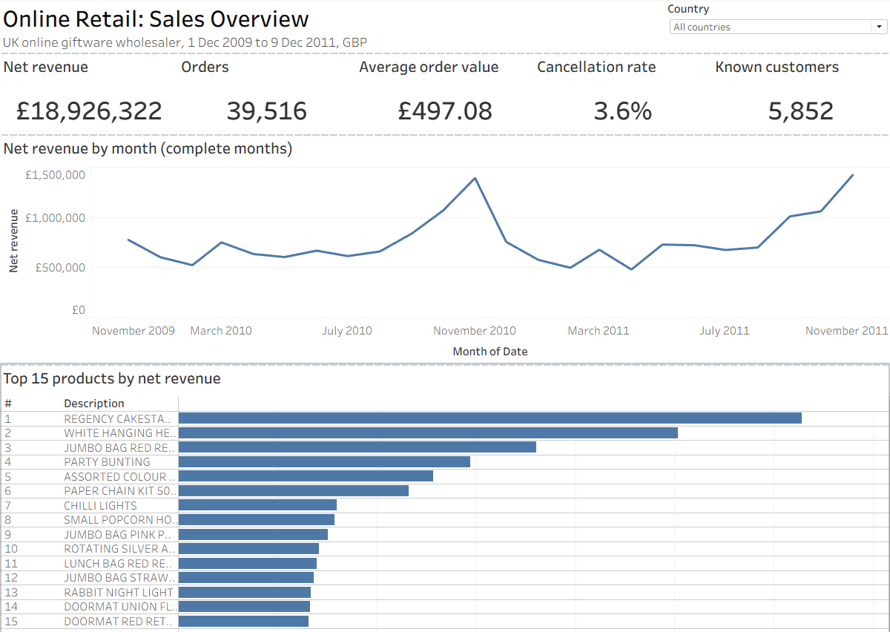
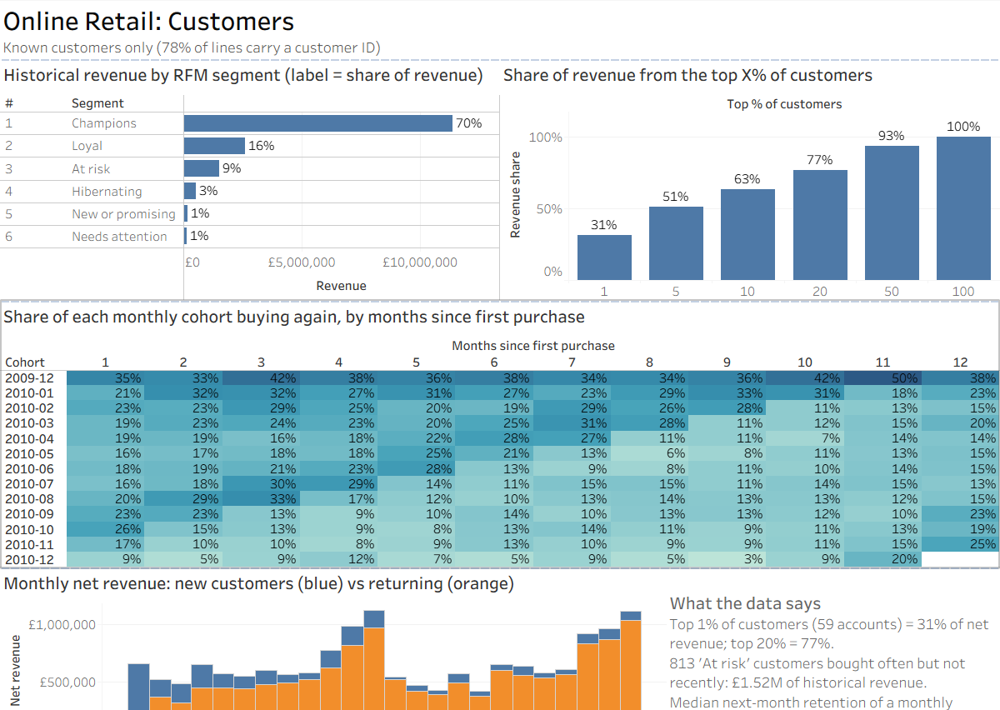
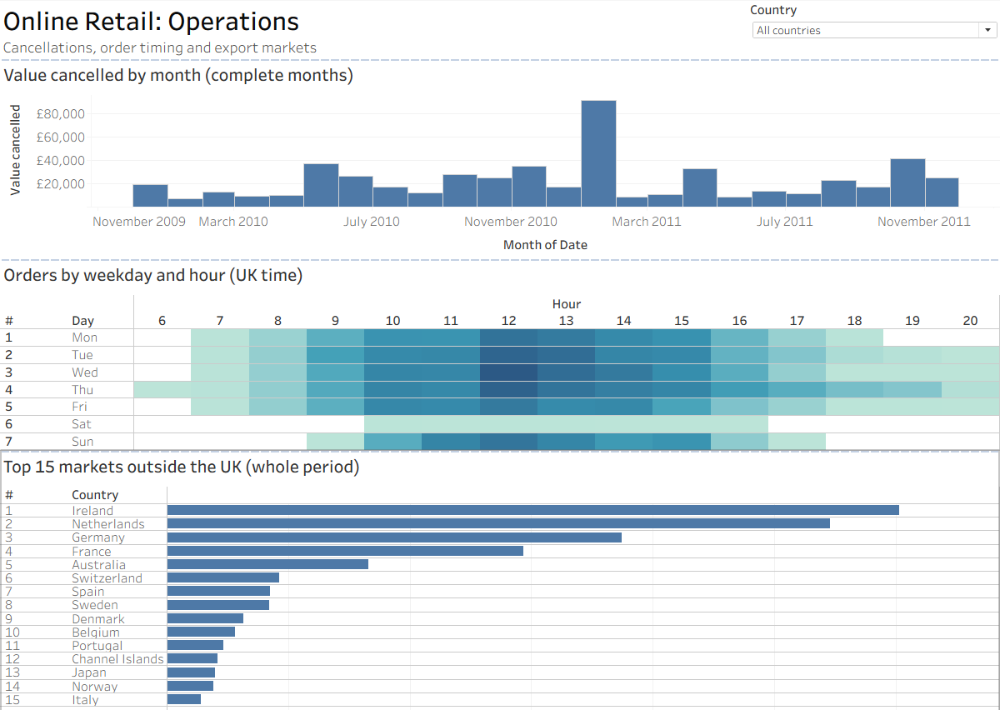
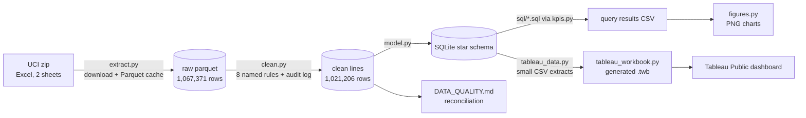
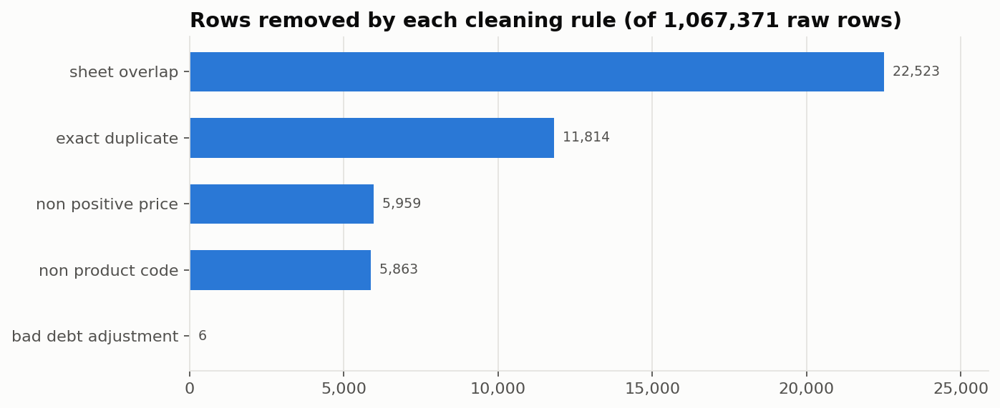

# Retail Sales & Customer Analytics

[](https://github.com/Hakkrax/retail-bi-analytics/actions/workflows/tests.yml)


End-to-end BI project on 1.07 million real invoice lines from a UK online gift wholesaler: Python data cleaning with a full audit trail, a SQLite star schema, ten documented SQL analyses, and an interactive Tableau Public dashboard.

> **Live dashboard:** [Tableau Public](https://public.tableau.com/app/profile/faheem.niyas/viz/retail_dashboard_17931009730360/SalesOverview) (3 dashboards: Sales Overview, Customers, Operations)
> **Case study:** [docs/CASE_STUDY.md](docs/CASE_STUDY.md)

[](https://public.tableau.com/app/profile/faheem.niyas/viz/retail_dashboard_17931009730360/SalesOverview)

<details><summary>Customers and Operations dashboards</summary>




</details>

## Business questions

The company sells giftware online, mostly to wholesalers. Management wants to know:

1. How is revenue trending, and how seasonal is it?
2. How much value is lost to cancellations, and where?
3. Which products and markets matter most?
4. How concentrated is revenue among customers, and which customers are slipping away?
5. Do new customers come back?

## Headline results

All figures are produced by `python -m retail_bi.pipeline` from the cleaned data (1 Dec 2009 – 9 Dec 2011, GBP).

| Metric | Value |
|---|---:|
| Net revenue (sales − cancellations) | £18.93M |
| Gross product sales | £19.64M |
| Cancelled value | £716k (3.65% of gross sales) |
| Orders | 39,516 |
| Average order value | £497 |
| Known customers | 5,852 across 41 countries |
| Jan–Nov 2011 vs Jan–Nov 2010 net revenue | +2.3% |

**What the data says**

- **Growth is flat; seasonality is strong.** Jan–Nov 2011 was only 2.3% above the same months of 2010. November is the peak both years (£1.39M and £1.43M), roughly twice a typical spring month.
- **Revenue is highly concentrated.** The top 1% of customers (59 accounts) produced 31% of net revenue; the top 20% produced 77%.
- **There is a clear re-engagement target.** 813 customers scored "At risk" in the RFM model (bought often, but not recently). They account for £1.52M of historical revenue.
- **A third of cancelled value comes from two orders.** A 74,215-unit order (Jan 2011) and an 80,995-unit order (Dec 2011) were each cancelled 12–16 minutes after being placed: £245,653 together. Excluding both orders and their cancellations, the cancellation rate is 2.4%.
- **Repeat buying is modest.** The median share of a monthly cohort that buys again the following month is ~20%.
- **Outside the UK (85% of revenue), a few wholesale accounts dominate.** Ireland's £603k comes from 3 customers; Netherlands orders average £2,545.
- **Trading pattern:** Thursday is the busiest day and 12:00 the busiest hour. Saturday is effectively closed (orders on one Saturday in two years).

## What this project does *not* claim

- **No profit or margin.** The dataset has selling prices but no cost data, so gross profit and margin cannot be calculated honestly.
- **No inventory turnover.** There are no stock levels.
- **Customer metrics cover 78% of lines.** 227,045 lines (£2.57M) have no customer ID. They count towards revenue but not towards customer KPIs.
- **The first months over-count "new" customers.** The data starts in Dec 2009; customers who bought before then look new.

## Architecture



**Star schema** (`data/processed/retail.db`)

| Table | Grain | Rows |
|---|---|---:|
| `fact_sales_line` | one product line on an invoice (sale or cancellation) | 1,021,206 |
| `dim_product` | stock code, most common description | 4,735 |
| `dim_customer` | customer, home country, cohort month | 5,875 |
| `dim_date` | calendar day, with `is_complete_month` | 739 |
| `data_quality_log` | one row per cleaning rule | 12 |

## Data cleaning

Every row is either kept or removed by a named rule, and the line value of each group is logged. The pipeline refuses to finish unless **kept + removed value equals raw value to the penny**.



| Rule | Rows removed | Why |
|---|---:|---|
| `sheet_overlap` | 22,523 | The two yearly sheets both contain 1–9 Dec 2010 |
| `exact_duplicate` | 11,814 | Same product, quantity, price and time repeated on one invoice |
| `non_positive_price` | 5,959 | £0 write-offs ("damaged", "check", "?") |
| `non_product_code` | 5,863 | Postage, Amazon fees, bank charges, manual adjustments, gift vouchers, test codes |
| `bad_debt_adjustment` | 6 | Accounting entries (invoice prefix `A`) |

Full log: [reports/DATA_QUALITY.md](reports/DATA_QUALITY.md). Rule rationale and edge cases: [docs/CASE_STUDY.md](docs/CASE_STUDY.md#data-cleaning-decisions).

## SQL analyses

Each file in [`sql/`](sql/) opens with the business question it answers and its grain. All run on SQLite 3.25+ and use CTEs and window functions (`LAG`, `NTILE`, `RANK`, running `SUM`).

| File | Question |
|---|---|
| `01_kpi_summary.sql` | Headline KPIs |
| `02_monthly_trend.sql` | Monthly revenue with month-over-month and year-over-year growth |
| `03_top_products.sql` | Top 25 products, revenue share, cumulative share |
| `04_country_performance.sql` | Revenue, AOV and cancellation rate by market |
| `05_customer_rfm.sql` | RFM scoring and segments |
| `06_cohort_retention.sql` | Monthly cohort retention matrix |
| `07_new_vs_returning.sql` | Revenue from new vs returning customers |
| `08_cancellations.sql` | Products losing the most to cancellations |
| `09_weekday_hour.sql` | Order timing by weekday and hour |
| `10_customer_pareto.sql` | Revenue concentration by customer percentile |

KPI formulas (SQL, Tableau and Power BI DAX versions): [docs/KPI_DEFINITIONS.md](docs/KPI_DEFINITIONS.md).

## Run it

Requires Python 3.10+. The dataset (45.6 MB) is downloaded on first run.

```bash
python -m venv .venv
# Windows: .venv\Scripts\activate    macOS/Linux: source .venv/bin/activate
pip install -r requirements.txt
pip install -e .
python -m retail_bi.pipeline         # ~3 min first run (Excel read), ~1.5 min after
python -m retail_bi.tableau_workbook # Tableau extracts + workbook (~35 s)
pytest                               # 43 tests
```

Outputs:

| Path | Contents |
|---|---|
| `data/processed/retail.db` | SQLite star schema |
| `exports/*.csv` | Full star-schema tables (for Power BI or a manual Tableau build) |
| `tableau/data/*.csv` | Small dashboard extracts, one block per country plus "All countries" |
| `tableau/retail_dashboard.twb` | Generated Tableau workbook: 14 sheets, 3 dashboards |
| `reports/query_results/*.csv` | Result of every SQL file |
| `reports/DATA_QUALITY.md` | Cleaning log and reconciliation |
| `docs/figures/*.png` | Charts used in this README |

## Tests

`pytest` runs 43 tests:

- **Cleaning rules:** a 15-row fixture with one deliberate example of every data problem; each rule must catch exactly its row, row counts must be conserved and revenue must reconcile.
- **Schema and SQL:** the fixture is loaded into a temporary database, foreign keys are checked, every SQL file is executed and key KPIs are asserted against hand-calculated values. Rebuilding twice gives identical results.
- **Tableau workbook:** extracts reconcile with the SQL KPIs, countries add up to the total, and every field, sheet and parameter the workbook refers to exists. (This checks the file's structure; only Tableau itself can show it renders.)
- **Full dataset** (skipped until the pipeline has run): no invalid prices or quantities, no duplicate lines, no fee codes, correct date range, reconciliation holds.

## Project structure

```
retail-bi-analytics/
├── src/retail_bi/
│   ├── config.py      paths, non-product codes
│   ├── extract.py     download, Excel → Parquet cache, column checks
│   ├── clean.py       standardisation + 8 audited cleaning rules
│   ├── model.py       star schema DDL, SQLite load, CSV exports
│   ├── kpis.py        runs every sql/*.sql file
│   ├── figures.py     README / case-study charts
│   ├── tableau_data.py      dashboard CSV extracts
│   ├── tableau_workbook.py  generates the .twb workbook
│   └── pipeline.py    CLI entry point, reconciliation, quality report
├── sql/               10 documented analytical queries
├── tests/             pytest suite
├── tableau/           generated workbook + its CSV extracts
├── docs/              case study, KPI definitions, Tableau guide, figures
└── reports/           generated quality report and query results
```

## Data source and licence

Chen, D. (2012). *Online Retail II* [Dataset]. UCI Machine Learning Repository. https://doi.org/10.24432/C5CG6D — licensed under [CC BY 4.0](https://creativecommons.org/licenses/by/4.0/). The data is downloaded at run time and is not stored in this repository.

Code: MIT licence (see [LICENSE](LICENSE)).
