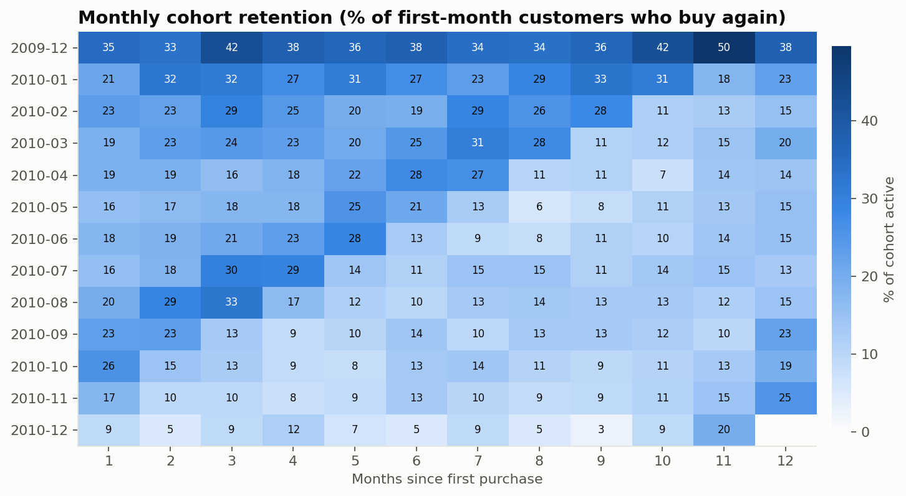

# Case study — Retail Sales & Customer Analytics

**Role:** sole developer and analyst · **Stack:** Python (pandas), SQLite, SQL window functions, pytest, Tableau Public · **Data:** UCI Online Retail II (CC BY 4.0), 1,067,371 invoice lines

## 1. Context

A UK online giftware company, selling mostly to wholesale customers, recorded every invoice line for two years (Dec 2009 – Dec 2011). The data is real and messy: it was exported as two overlapping Excel sheets and mixes product sales with postage, marketplace fees, bank charges, write-offs and accounting adjustments.

The aim was a dashboard a sales manager could trust, which meant the numbers had to be reproducible and every exclusion explainable.

## 2. Problem statement

> Where does revenue come from, how much leaks through cancellations, which customers carry the business, and are new customers sticking?

Success criteria set before building:

1. Every raw row is either kept or removed for a named, documented reason.
2. Revenue reconciles to the penny between raw and cleaned data.
3. Every KPI has one written definition used identically in SQL and the dashboard.
4. KPIs the data cannot support (profit, margin, inventory turnover) are stated as out of scope, not approximated.

## 3. Architecture

```
UCI zip (Excel, 2 sheets)
  └─ extract.py ── download once, validate columns, cache as Parquet (80 s Excel read → ~8 s re-reads)
       └─ clean.py ── standardise types/text, 8 ordered rules, audit log
            └─ model.py ── SQLite star schema (fact + 3 dims + quality log), FK check, atomic swap
                 ├─ sql/*.sql ── 10 analyses (CTEs, LAG, NTILE, RANK, running sums)
                 ├─ exports/*.csv ── Tableau Public data sources
                 └─ figures.py ── static charts for docs
```

**Why a star schema instead of one wide CSV?** It keeps product and customer attributes in one place (in the raw data 1,232 stock codes carry more than one description spelling), it gives Tableau proper relationships instead of duplicated text, and it mirrors how BI teams model sales data in a warehouse.

**Why SQLite?** Zero setup for a reviewer, standard SQL with window functions, and the schema and queries move to MySQL or PostgreSQL with minor syntax changes.

**Why rebuild atomically?** The database is written to a temp file and swapped in only after the foreign-key check passes, so a failed run never leaves a half-built database for the dashboard.

## 4. Data cleaning decisions

Profiling came first; the rules came from what the data showed, not from a template.

| Finding | Evidence | Decision |
|---|---|---|
| The two yearly sheets overlap | 1,088 invoices (22,523 lines) appear on both, all dated 1–9 Dec 2010 | Keep the first sheet's copy. Removing these by invoice rather than as "duplicates" makes the cause visible in the log. |
| Repeated lines within an invoice | 11,814 lines identical in product, quantity, price, time, customer | Remove. Two pairs differed only in the description spelling ("SPOTTY BUNTING" vs "BUNTING , SPOTTY"), found by a full-data test; the description was dropped from the duplicate key because the stock code is the product identity. |
| Non-product codes | `POST`, `DOT`, `M`, `AMAZONFEE`, `BANK CHARGES`, `CRUK`, gift vouchers `GIFT_0001_*`, `TEST001`… | Remove from product analysis (5,863 lines). The list is in `config.py` with a comment per code. |
| £0 price lines | 5,959 lines with descriptions like "damaged", "check", "?", "thrown away" | Remove: they are stock write-offs, not sales. |
| Bad-debt adjustments | 6 invoices prefixed `A`, values up to −£53,594 | Remove: accounting entries. |
| Cancellations | Invoices prefixed `C` with negative quantity | **Keep** as negative revenue so net revenue is correct; tag `line_type = 'cancellation'`. |
| Missing customer ID | 227,045 kept lines (£2.57M) | **Keep** for revenue; exclude from customer KPIs. Dropping them would understate revenue by 13.6%. |
| Non-geocodable countries | `EIRE`, `RSA`, `USA`, `Unspecified`, `European Community` | Map to names Tableau recognises, or `Unknown`. |
| Partial final month | Data ends 9 Dec 2011 | `dim_date.is_complete_month` flag; growth and cohort charts exclude it. |

Two rules (`stock_adjustment`, `cancel_positive_qty`) caught 0 rows in this data because earlier rules already removed those cases. They stay as guards and are tested with fixture rows.

**Reconciliation.** Raw line value (£19,287,250.57) = kept (£18,926,322.07) + removed (£360,928.50). The pipeline raises an error if the difference exceeds £0.01.

## 5. Results

| | |
|---|---|
| Net revenue | £18.93M (gross £19.64M, cancellations −£716k) |
| Orders / AOV | 39,516 orders, £497 average |
| Growth | Jan–Nov 2011 +2.3% vs Jan–Nov 2010 |
| Seasonality | November peak both years (£1.39M, £1.43M) |
| Concentration | Top 1% of customers = 31% of revenue; top 20% = 77% |
| RFM | 1,322 Champions = 70% of revenue; 813 At-risk customers = £1.52M historical revenue |
| Retention | Median next-month retention of monthly cohorts ≈ 20% |
| Cancellations | Two very large orders cancelled 12–16 minutes after placement = 34% of cancelled value |



### Recommendations a manager could act on

1. **Win-back campaign for the 813 "At risk" customers** — frequent past buyers who have gone quiet. They already know the catalogue, and the group represents £1.52M of historical revenue.
2. **Protect the top 59 accounts.** Losing a handful would move annual revenue noticeably; they warrant account management rather than generic marketing.
3. **Prepare stock and staff for September–November.** Revenue roughly doubles; Q4 planning matters more than any other period.
4. **Add an order-size check** before confirming orders over a threshold. Two mistaken bulk orders accounted for a third of all cancelled value.
5. **Fix customer capture.** 22% of lines have no customer ID, which limits every customer metric.

## 6. Testing

34 pytest tests, all passing at the time of writing:

- A 15-row fixture with one deliberate example of each data problem; each rule must catch exactly its row.
- Row conservation and revenue reconciliation on the fixture.
- The fixture is loaded into a temporary SQLite database; every SQL file runs; KPI values are checked against hand calculations; rebuilding twice gives identical results.
- Full-dataset checks: no invalid prices or quantities, no duplicate lines, no fee codes, expected date range.

The full-dataset duplicate test is what caught the description-spelling duplicates — a case the fixture hadn't anticipated.

## 7. Limitations

- **No cost data** → no profit, margin or product profitability.
- **No stock data** → no inventory turnover or stock-outs.
- **Left-censored customers.** Customers who bought before Dec 2009 appear "new" in the first months; the Dec 2009 cohort's high retention reflects existing customers.
- **Country is per invoice.** A customer's "home country" is their most frequent invoice country.
- **Recency is relative to the dataset end** (10 Dec 2011), not today.

## 8. What I would do next

- Move the database to PostgreSQL and schedule the build (the pattern used in my ETL project).
- Basket analysis (frequently bought together) from invoice lines.
- A demand forecast for Q4 by product category, once categories are added (the source has none; they would need text classification of descriptions).

## Source

Chen, D. (2012). *Online Retail II* [Dataset]. UCI Machine Learning Repository. https://doi.org/10.24432/C5CG6D — CC BY 4.0.
